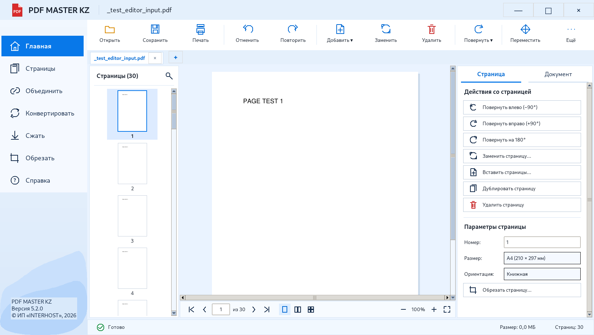

# PDF MASTER KZ 5.2

**PDF MASTER KZ** — настольный редактор PDF для Windows, разработанный ИП «INTERHOST» (автор: Советбаев Роллан, 2026).



## Возможности

- Просмотр PDF, миниатюры страниц, масштаб, несколько документов во вкладках.
- Поворот, вставка, удаление, замена, дублирование, выделение Ctrl/Shift, перемещение страниц мышью.
- Отмена и повтор действий (Ctrl+Z / Ctrl+Y).
- Объединение и разделение PDF, обрезка, оптимизация и сжатие.
- Создание PDF из JPG/PNG.
- Поиск пустых и повторяющихся страниц, проверка ориентации.
- Штампы, изображения подписей и водяные знаки.
- Локальная работа с файлами без обязательной отправки в облако.

## Запуск из исходников

Требуются Windows 10/11 (x64) и Python 3.12.

```powershell
py -3.12 -m venv .venv
.venv\Scripts\python.exe -m pip install -r requirements.txt
.venv\Scripts\python.exe launch_pdf_master.py
```

Альтернативно: запустите `START_PDF_MASTER_KZ_5_2.bat`.

## Сборка EXE

`BUILD_PDF_MASTER_KZ_EXE_WITH_ICON.bat` собирает автономную Windows-версию с иконкой через PyInstaller. Сборку необходимо выполнять на Windows и тестировать на целевой системе. EXE в этом репозитории не включён.

## Примечания

- Обработка PDF выполняется локально. Рекомендуется сохранять резервные копии важных документов.
- Изображение подписи **не является** криптографической ЭЦП.
- Исходные коды проекта предоставлены для ознакомления до окончательного определения режима распространения. **Наличие исходников в GitHub само по себе не предоставляет разрешения на копирование, модификацию или распространение**, кроме прав, предоставляемых применимым законодательством и лицензиями зависимостей.
- В проекте используется **PyMuPDF**; до публичного распространения необходимо выполнить требования применимой лицензии PyMuPDF (AGPL либо коммерческие условия), а также проверить лицензии прочих компонентов. Отдельный файл `LICENSE` не добавлен, поскольку единая лицензия для исходного кода владельцем не выбрана.

## Контакты

- Сайт: https://coolkaz.kz
- Поддержка: support@coolkaz.kz
- Автор: Советбаев Роллан, ИП «INTERHOST»
